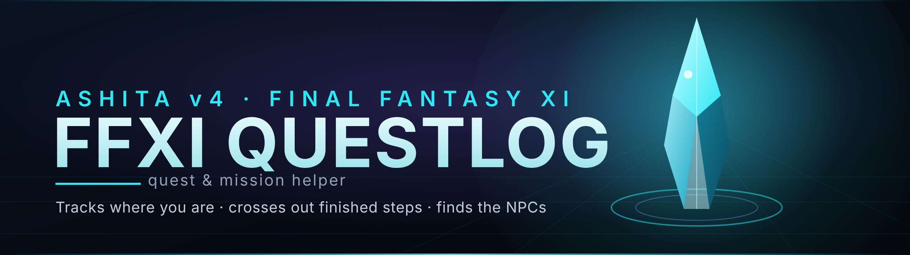
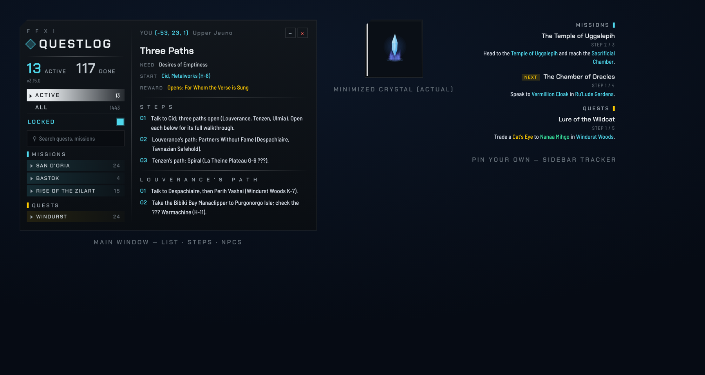

# FFXI Questlog

**Author:** Guabancex &nbsp;·&nbsp; **Version:** 3.26.3 &nbsp;·&nbsp; **For:** Ashita v4 — Final Fantasy XI

A quest and mission helper that reads your own quest log, mission log and key
items and shows, at a glance, **which step you're on**, **what you've already
done**, and **where the NPCs are** — zone, coordinates, and (when you're in the
zone) how far and which way.

It only reads what the game already sends your client. **It never acts for you.**
The one thing it can send is a party-chat line, and only when you press **SHARE**
or type `/ql share`.

---

## Install

1. Download `FFXI-Questlog-v3.26.3.zip` and unzip it.
2. Copy the **whole `FFXIQuestlog`** folder into `Ashita/addons/` (replace everything when updating -- `lib`, `data` and `sounds` change too, not just `ffxiquestlog.lua`).
3. In game: `/addon load ffxiquestlog`
4. **Zone once, or log out and back in.** That's when the game sends your quest
   log, mission log and key items. Questlog remembers them from then on.

To load it every session, add `/addon load ffxiquestlog` to your Ashita startup
script (e.g. `scripts/default.txt`).

---

## What it does

- **One step list.** Each quest's steps the game tracks (they tick themselves) and
  its written walkthrough are one list: the walkthrough's lines sit under the step
  they belong to, and any extra walkthrough step gets its own tick box.
- **Live progress.** Reads your quest and mission logs and marks the exact step
  you're on; finished steps are struck out.
- **NPC locations.** Every step's NPCs with zone, x/y/z, and a live distance and
  compass direction when you're in the same zone. Click an NPC to locate it.
- **Get-there directions, on every step.** For a new player, each step's travel is
  written out the way the old fan wiki did — *Go to West Ronfaure → Zone out of
  Northern San d'Oria at (C-8)*, *Talk to the Hut Door → Ghelsba Outpost (G-5)* —
  picking the quickest warp (Home Point / Survival Guide / outpost). Every hop is a
  tick box you check off as you go. Other ways there (another warp, or walking) tuck
  under a small **OTHER WAYS** toggle so the list stays short.
- **The folded crystal.** Minimize the window to a home-point **crystal** you can
  park anywhere; a compact step card can ride beside it.
- **Your own tracker.** Pin the missions and quests you care about to the
  right-side tracker — it starts **clear** and shows only what you pin. Pin a
  mission and the pin **follows the storyline**: finish it and the next mission in
  that line is pinned for you automatically. Each tracker entry has a **HOW TO GET
  THERE** button for the route to its current step.
- **Arrow to the NPC.** A small arrow points to your step's NPC when you're in
  their zone (or to the zone line on the way there), turned to the way you face,
  with the distance. Drag it anywhere; it stays put.
- **Step and quest-done moments.** A short card, ring and chime when a step ticks
  and when a quest or mission is finished, with its rewards.
- **Progress page.** Your completion ring, what's nearly done, each storyline as a
  chain of missions, and quests by area (`/ql progress`).
- **Time, weather and moon.** Steps that need night, a time window, a weekday,
  weather or a moon phase say so, with how long until it's right (Vana'diel time).
  The last weather is remembered, so a reload or an update doesn't make you zone first.
- **Repeatable timers.** After you finish a repeatable quest it shows when it's
  ready again, and tells you once it is. Timers are saved with your character, so they
  carry over restarts and updates.
- **Share to party.** Post *quest – step 3/7: what to do (place)* to party chat.
- **Outlands walkthroughs.** Kazham, Norg, Rabao and Zi'Tah quests have full
  steps from FFXIclopedia. Quests the game doesn't track get **tick boxes** on
  their steps, and the step list moves on as you tick them.
- **Rewards & JP.** Reward items show as icons; optional Japanese item and zone
  names for the JP client.
- **Reads everything locally.** No server traffic, no automation.

---

## Using it

| Area | What it does |
|------|--------------|
| **Window** | The full list of your active quests and missions. Click one to open its steps, NPCs and rewards. Each row shows a small tag on the right: **step 3/7**, **NOW** / **WAIT** when it needs a time, moon or weather (hover for which), or a repeatable's **AGAIN IN** timer and **READY**. Hover and selection glide — no hard snap. |
| **Tracker** (right or left of screen) | Sits on the **right** of the screen, the **left**, or **free** -- drag it anywhere by an empty spot while unlocked, and it reopens there (`/ql lock` pins it). Click **Step list** in the window's side menu to switch (or `/ql tracker left|right|free`); its text and buttons hug that edge (free: the nearer one). Shows **only what you pin**. Pin from the window or a tracker row; close one out with the **×**. `/ql auto` also lists your current + next missions and active quests. |
| **Crystal** | The folded state. Click to open, drag to move, lock to pin it in place. |
| **Filters & search** | Narrow to what's active, or `/ql find <text>`. |

---

## Commands

| Command | Does |
|---------|------|
| `/ql` | Show / hide the window |
| `/ql mini` | Fold to the crystal / open the full window |
| `/ql step` | Step card beside the crystal on / off |
| `/ql progress` | Open the progress page (completion, storylines, areas) |
| `/ql arrow on\|off` | Arrow to your step's NPC on / off |
| `/ql arrow flip` | Turn the arrow round if it points the wrong way |
| `/ql arrow home` | Put the arrow back at the top of the screen |
| `/ql share` | Post the focused entry's current step to party chat |
| `/ql sound` | Chimes on / off |
| `/ql tracker left\|right\|free` | Where the pinned step list sits: a side of the screen, or free to drag (also in the window's side menu) |
| `/ql trackall` | Tracker: **pins only** (default) ↔ also current + next missions and active quests |
| `/ql auto` | Auto checklist on / off (steps tick as you talk, trade, defeat and travel) |
| `/ql find <text>` | Search quests and missions |
| `/ql side left\|right\|saved` | Where the window opens from the crystal |
| `/ql pos <x> <y>` | Put the window at a screen position |
| `/ql lock` | Lock / unlock the window and crystal in place |
| `/ql opacity 30-100` | Window opacity (100 = solid) |
| `/ql scale auto\|0.75-3` | UI size. **Auto** by default from your game resolution (1080p 1×, 1440p 1.25×, 4K 2×); set a number to override. Applies at once. Also the **Size** slider in the window's side menu. |
| `/ql scale tracker auto\|0.75-3` | The pinned step list's own size (**Auto** = the same as the window). Also the **Step list size** slider. |
| `/ql unscripted` | Show / hide entries that have no step list |
| `/ql jp` | Japanese item and zone names (JP client) |
| `/ql help` | List the commands in game |

---

## Data & privacy

Questlog is **read-only**. Your progress comes from packets the server already
sends your client (your quest log, mission log and key items) plus the items you
carry. Steps the game can't see, you tick off yourself. No action is ever taken
for you. Only **SHARE** / `/ql share` sends anything: one line to party chat.

Step lists are generated from retail-accurate quest and mission scripts and
community wikis (FFXIclopedia, CC BY-SA).

---

*FFXI Questlog is a fan-made addon for Final Fantasy XI. Final Fantasy XI is a
trademark of Square Enix. Not affiliated with or endorsed by Square Enix.*
