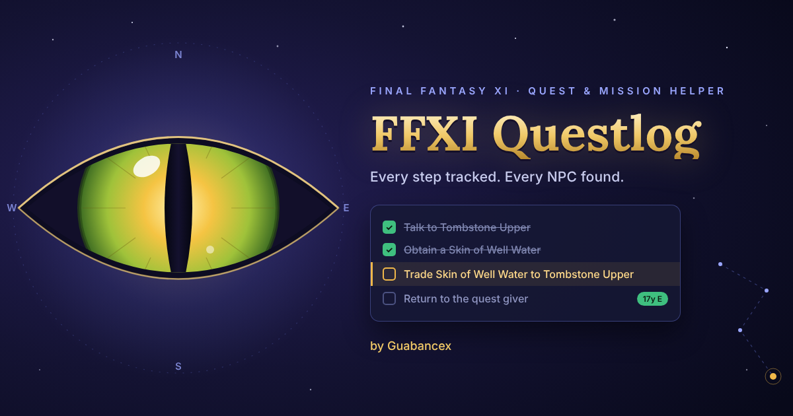
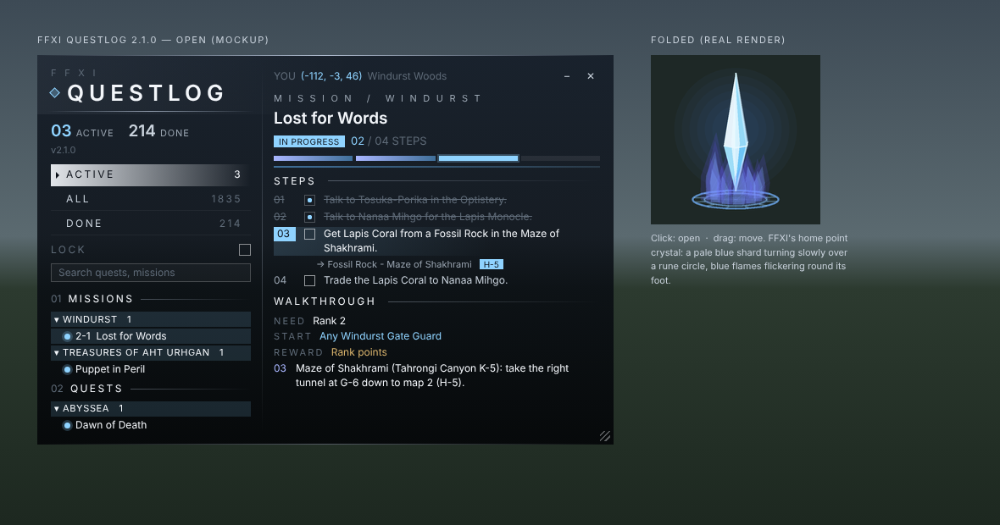

# FFXI Questlog

**Author:** Guabancex<br>
**Version:** 2.2.0<br>
**For:** Ashita v4 · Final Fantasy XI

FFXI Questlog is a quest and mission helper. It keeps track of which part of
each quest or mission you're on, crosses out the steps you've finished, and
shows where the NPCs are: their zone, their x, y, z coordinates and, when you're in the
same zone, how far away they are and in which direction.

It only reads what the game already sends your client. It never sends anything
to the server and never acts for you.



---

## Installing

1. Download `FFXI-Questlog-v2.2.0.zip` and unzip it.
2. Copy the `FFXIQuestlog` folder into `Ashita/addons/`.
3. In game, type `/addon load ffxiquestlog`.
4. **Zone or log out and back in once.** That's when the game sends your quest
   log, mission log and key items. FFXI Questlog remembers them after that.

To load it every time, add `/addon load ffxiquestlog` to your Ashita startup
script (for example `scripts/default.txt`).

### Updating from an older version

Versions before 1.3.1 were in a folder called `QuestLog`.

1. Delete the old `Ashita/addons/QuestLog` folder.
2. Copy in the new `FFXIQuestlog` folder.
3. If your startup script says `/addon load questlog`, change it to
   `/addon load ffxiquestlog`.

---

## The window

In Aether's look, so it sits with Guabancex's HUD: a dark ink panel with its
top-left corner cut (the cut lit in the accent), a faint edge all round, a
**sidebar** on the left and the steps on the right, in Aether's typeface
(Barlow Semi Condensed, in `fonts/`). **Cyan** always means "you are here":
the current step, the selected row, step numbers and progress. **Gold** marks rewards. Finished
things fade to grey and are struck out.

**Lock:** the **Lock** switch under the filters pins the window and the
minimized crystal where they are, so a stray drag can't move them. Flip it off
(or type `/ql lock`) to move them again. It's remembered between logins.

**Opacity:** the panel lets the game show through. `/ql opacity 30-100` sets
how solid it is (100 = solid). It starts at 82.

**Sidebar** (left)
- **F F X I** over the **QUESTLOG** wordmark: spaced white capitals after a
  small pale blue diamond, with a hairline under it.
- Big counters for quests and missions in progress (pale blue) and done, and
  the version.
- **ACTIVE** and **ALL** rows, each with a count (ALL is everything you haven't
  finished). The open one sits on a bright light band in dark ink with a chevron,
  as in FFXV's menus. Completed quests and missions are left off the list; the DONE
  counter above still counts them.
- A search box.
- Your missions and quests, grouped by area. Every area starts folded when
  the addon loads; click one to open it. A small dot shows the state of
  each: pale blue with a halo for in progress, a dash for not started. Hover a name that's too long for the sidebar to read it all.

**Steps** (right: the quest or mission you picked)
- **-** minimizes the window and **x** closes it (top right).
- Where it's from (for example MISSION / WINDURST), its name (long names
  wrap), and its status.
- How many steps are done (for example **02 / 04 STEPS**) and a bar with one
  segment per step: periwinkle-to-steel for done, a glowing pale blue one for
  the step you're on, faint for the rest.
- Each step with its number, a square tick box and its text. The step you're
  on has its number in a pale blue block. Finished steps fade and are struck
  out.
- **How to get there, step by step:** when the current step's NPC is in another zone, a folded **+ HOW TO GET
  THERE** line under it shows the quickest way in one line; click it and numbered steps walk you there, the way the old fan wiki wrote them, with the game's own map grids:

      01 Go to West Ronfaure
         -> Zone out of Northern San d'Oria at (E-7)
      02 Go to Ghelsba Outpost
         -> Zone out of West Ronfaure at (F-6)
      03 Talk to Hut Door
         -> Hut Door - Ghelsba Outpost (G-5)

  The quickest way comes first (a Home Point, Survival Guide or outpost warp when that's shorter: "Warp to Port
  Windurst -> Any Home Point: pick Port Windurst #2 (F-6)"). Under it, always shown, the ways that don't need that warp:
  **DON'T HAVE THAT SURVIVAL GUIDE? BY HOME POINT** (or outpost warp), then **OR WALK FROM HERE** - for a new
  character that hasn't touched any warps yet. The NPC lines show
  their map grid too. Built from the server's own zone lines and teleports; the grids come from the game's own maps.
- Your own position at the top: **YOU (x, y, z)** and the zone you're in, in the
  order Ashita shows them: x and y on the map, z the height.
- Under each open step: the NPCs involved, their zone and coordinates as
  **(x, y, z)** the same way (x and y on the map, z the height), for example
  **(167, 45, 0)**. When you're in that zone, a pale blue tag shows
  the distance and direction (for example **17y E**).
- Click a step's tick box (or its text) to mark it done or not done yourself.
  **Clear my ticks** removes your own ticks for that quest.
- **Walkthrough** under the steps, when there is one: what you need, where it
  starts, the reward (in gold), numbered steps and notes.
- **More on BG-Wiki** at the bottom. **Open page** opens the BG-Wiki page in
  your browser. **Copy link** copies the link instead.

**Moving and resizing**
- Drag the window by its background to move it.
- Drag the bottom-right corner to resize it (smallest 560 x 360).

### Minimized: the crystal

Click **-** in the header, or type `/ql mini`, to fold the window down to
FFXI's home point crystal: a tall, pale blue shard that turns slowly and
floats over a glowing rune circle, with blue-violet flames flickering round
its foot and a glint at its tip now and then. Hover it to see the quest you
picked (or your first one in progress) and the step you're on. Click it to
open the full window at the size you left it; drag it to move it.

---

## Commands

| Command | What it does |
|---|---|
| `/ql` or `/questlog` | Show or hide the window |
| `/ql mini` | Minimize to the crystal, or open the full window again |
| `/ql lock [on\|off]` | Lock the window and the crystal in place, or unlock them |
| `/ql opacity <30-100>` | How solid the window is (100 = solid) |
| `/ql find <text>` | Search all quests and missions |
| `/ql unscripted` | Hide or show the quests and missions that have no step list (shown by default) |
| `/ql auto` | Turn the auto checklist off or on |
| `/ql check` | Says whether your quest log, mission log and key items have arrived, and for the quest you picked, why each step is ticked or not |
| `/ql pos <x> <y>` | Move the window to this screen position |
| `/ql help` | Show the command list in chat |

---

## How progress is tracked

FFXI Questlog reads what the game already tells your client:

| From the game | What it marks done |
|---|---|
| Quest log (in progress and completed) | Starting a quest. Finishing one marks every step done. |
| Mission log (current and completed missions) | The same, for missions |
| Key items | Any step that gives you that key item |
| Items you carry (inventory, satchel, sack, case, wardrobes) | Any step that gives you that item |

When a step is marked done this way, every step before it counts as done too.

### Auto checklist

The game doesn't tell your client how far you are in a quest after talking to
someone or making a trade (the server keeps that to itself). So FFXI Questlog
watches what happens instead, and ticks the step for every quest or mission
you're on (and the one you picked):

| When | It ticks |
|---|---|
| You get a cutscene or menu from an NPC (talking or trading to it) | That NPC's talk or trade step |
| You use a ??? point | Its step, found by where you're standing (within 6 yalms) |
| A monster is defeated | Its "Defeat" step |
| You enter a zone | Its "Enter" step |

Only the next two open steps can be ticked this way, so chatting with an NPC
who shows up again later in the quest doesn't skip ahead. Ticking a step also
ticks every step before it, and a chat line says which step was done.
`/ql auto` turns the auto checklist off or on.

You can still tick or untick any step yourself: click its box **or its text**.
If something isn't ticking, `/ql check` lists each step and what it is waiting
for.

### Where the steps come from

The steps follow original FFXI. They're built from LandSandBoat, the open
project that recreates the retail game's quests and missions script by script:
who to talk to, what to trade, what to defeat, which zone to enter and what you
get, in the order the scripts handle them. Newer quests and missions have a
step script of their own; older quests are written into the NPCs' scripts, and
their steps are worked out from those (which events each NPC plays for the
quest and what each one does). That covers 883 quests and missions.

BG-Wiki is a supplement: every entry links to its page for the full
walkthrough, but the steps themselves are built in.

Quests and missions with no step list yet are listed like the rest; their page
says so and points to BG-Wiki. `/ql unscripted` hides them.

Some quests have hand-checked steps instead, written from the quest's script
with extra notes (for example Hitting the Marquisate, the Thief AF3 quest, and the Rhapsodies
mission Cauterize).
These live in `tools/overrides.py`, so a quest that reads wrong can be fixed
there and survives the next data rebuild.

Treat them as a guide. A script can't say everything, such as where a mob or
item comes from. For those, FFXI Questlog lists the NPCs involved and where they
stand, and every quest and mission links to its BG-Wiki page.

### Detailed walkthroughs (Bastok)

Every Bastok quest (all 93) also has a detailed walkthrough under its steps:
what you need, where it starts, the reward, whether it repeats, then numbered
steps with zones and map grids, where items drop or can be bought, timing and
weather, and the gotchas. They're written from the FFXIclopedia quest pages,
with the HorizonXI and BG-Wiki pages filling in where a page was thin. They
live in `data/guides.lua`, keyed by quest, so they survive a data rebuild.

### Detailed walkthroughs (San d'Oria missions)

All 24 San d'Oria missions, from Smash the Orcish Scouts to The Heir to the
Light, including each part of Journey Abroad, have walkthroughs: where each
one starts, the route with map grids, what to trade, the battlefields and boss
tips, and the rank, gil and rank points CatsEyeXI gives for it.

### Detailed walkthroughs (Bastok missions)

All 24 Bastok missions, from The Zeruhn Report to Where Two Paths Converge,
including each part of The Emissary, have walkthroughs too: where each one
starts, the route with map grids, what to trade, the battlefields and boss
tips, and the rank, gil and rank points CatsEyeXI gives for it. If a gate
guard won't give you the next mission, trade crystals to a Conquest Overseer.

### Detailed walkthroughs (Rise of the Zilart)

All 18 Rise of the Zilart missions, from The New Frontier to The Last Verse,
have walkthroughs: where each starts, the routes with map grids (Temple of
Uggalepih and the Den of Rancor, every Cermet Headstone, Quicksand Caves,
Delkfutt's Tower, Ro'Maeve, Ru'Aun Gardens and the Shrine), every
battlefield (all level 75 cap, 6 players, 30 minutes on CatsEyeXI) with boss
tips, which Ark Angel gives which shard, and how Awakening ties into the
Jeuno epilogue quests.

### Detailed walkthroughs (Chains of Promathia)

Every Chains of Promathia mission (all 43, from Ancient Flames Beckon to The
Last Verse, including the 3-3 and 5-3 route missions) has a walkthrough too:
level caps, zones and map grids, key items, battlefield tips for each boss,
and the rewards. They live in `data/mission_guides.lua`, keyed by mission.

### Detailed walkthroughs (Rhapsodies of Vana'diel)

Every Rhapsodies of Vana'diel mission (all 94, 1-1 to 3-35) has a walkthrough
as well. Up to Wisdom of Our Forefathers (2-25) they follow CatsEyeXI's own
mission scripts, including which story characters must be free (Tenzen,
Prishe, Aphmau, Lilisette, Cait Sith) for a cutscene to play, plus fight tips
for Ophiotaurus, Siren and Cetus. CatsEyeXI's RoV story currently stops after
2-25; the later missions are covered from BG-Wiki and marked as not yet
scripted on the server. Missions the generated list misnamed or misnumbered
(Set Free, Prime Number, From the Ruins and others) show their right names.

### Detailed walkthroughs (Windurst missions)

22 of the 24 Windurst missions, from The Horutoto Ruins Experiment to Doll of
the Dead, including each part of The Three Kingdoms, have walkthroughs: where
each one starts, the route with map grids, key items, the battlefields and the
rewards. They're written from the FFXIclopedia mission pages. Full Moon
Fountain (6-1) and Moon Reading (9-2) have none yet: their FFXIclopedia pages
couldn't be read.

### Detailed walkthroughs (Treasures of Aht Urhgan)

43 of the 48 Aht Urhgan missions have walkthroughs, from Land of Sacred
Serpents to Eternal Mercenary, written from the FFXIclopedia mission pages:
start points, routes, key items, battlefield tips (Khimaira 13, Lancelord
Gaheel Ja, the Lamiae, Gessho, Amnaf) and rewards. Some FFXIclopedia pages
only give the mission orders, so those walkthroughs are short. Confessions of
Royalty, Teahouse Tumult, Sentinels' Honor, Nashmeira's Plea and Ragnarok
have none yet (their pages couldn't be read); BG-Wiki still links from them.

### Detailed walkthroughs (Abyssea story)

The Abyssea main quests have walkthroughs in the Abyssea quest list, written
from FFXIclopedia: The Truth Beckons and Dawn of Death, the nine Cavernous
Maw boss quests (where each maw is, how it flags, how the reward works),
Tenuous Existence, Champions of Abyssea, Scars of Abyssea, Death and Rebirth,
Emissaries of God and the six caturae, Beneath a Blood-red Sky, The Wyrm God
(Shinryu) and the epilogue. A Journey Begins, The Forbidden Frontier, First
Contact, An Officer and a Pirate, Heart of Madness, Heroes of Abyssea and A
Sea Dog's Summons have none yet (their pages couldn't be read).

### Good to know

- Not yet tested in game: reading the quest log, the item checks and the
  direction tag. The direction assumes north is at the top of the map.
- Some storylines only report your current mission (Chains of Promathia, the
  add-on scenarios, Seekers of Adoulin and Rhapsodies of Vana'diel). For those,
  every earlier mission counts as done.

---

## Updating the quest data

Rebuild the data from a LandSandBoat checkout
(https://github.com/LandSandBoat/server):

```
python3 tools/build_quests.py <landsandboat> <landsandboat>/sql/zone_settings.sql data/quests.lua
```

It reads the quest and mission scripts, the quest, mission, key item, item and
zone lists, the NPC scripts, and the NPC list (`data/zones/*/npcs.yaml`, or
`sql/npc_list.sql` in older checkouts) for NPC names and positions. Any other
LandSandBoat-based server checkout works the same way.

---

## Files

```
FFXIQuestlog/
├── ffxiquestlog.lua       The addon: window, packets, step display
├── lib/log.lua            Quest and mission status, key items, progress, directions
├── data/quests.lua        Quests, missions, steps and NPC positions (generated)
├── data/guides.lua        Detailed walkthroughs (Bastok quests)
├── data/mission_guides.lua Detailed walkthroughs (Promathia missions)
├── tools/build_quests.py  Builds data/quests.lua from the server source
├── tools/overrides.py     Hand-checked steps for quests the builder gets wrong
├── README.md              This file
├── CHANGELOG.md           Every version and what changed
└── images/                The banner and window pictures used in this README
```

---

## Quest data

The quest data in `data/quests.lua` is generated from LandSandBoat's scripts
and data (quests, missions, key items, NPC positions and zone names). That data
belongs to its source project.

The walkthroughs in `data/guides.lua` and `data/mission_guides.lua` are summarized from the community wikis
FFXIclopedia (https://ffxiclopedia.fandom.com), the HorizonXI Wiki
(https://horizonffxi.wiki) and BG-Wiki (https://www.bg-wiki.com), whose text is
shared under CC BY-SA.

---

*FFXI Questlog v2.2.0 by Guabancex.*
